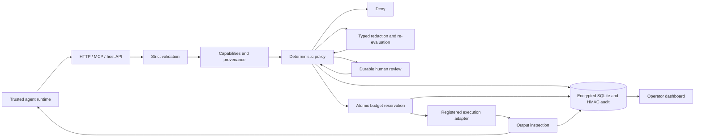
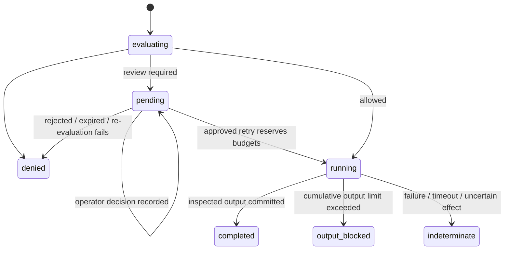

# Architecture

## Trusted configuration

The host provides principals, tenant membership, capability grants, handlers and tool definitions. Requests carry only a request ID, tool name and arguments. Model-written explanations, trust labels, identities, roles or approval booleans are not accepted as authority.

Each grant binds a tool's schema and metadata fingerprint. The registry freezes definitions and rejects registration after gateway construction. Sessions bind policy, registry and profile hashes. Changing any bound configuration invalidates existing sessions, including pending approvals.

Fingerprinting covers metadata and contracts, **not executable handler bytes**. Pin and verify the application/container artifact separately. Trusted host code can mutate its process and is outside the enforcement boundary.

## Evaluation order

1. Bound and clone JSON; reject invalid tool names, extra request fields and malformed IDs.
2. Authenticate session ownership, expiry, configuration, ancestor chain and revocation.
3. Find an existing request by `(session ID, request ID)`. Reject argument mismatches; return cached terminal outcomes; never automatically retry a running record.
4. Charge a new request against its session and all ancestor call budgets.
5. Validate the tool schema and capability constraints; enforce origins and inherited data-flow restrictions.
6. Run bounded inspection and declarative policy. Explicit deny wins. No allow or approval means deny.
7. Apply only configured field redaction, then validate schema, capabilities and policy again. Residual detected secret/PII egress is denied.
8. When required, persist a request-bound approval and return. An operator may approve, reject or cancel it. Retry re-evaluates current policy, state and revocation before consuming approval.
9. Reserve cost and concurrency in a `BEGIN IMMEDIATE` transaction. Persist `running` and append the start audit event **before** invoking the handler.
10. Inspect and validate the result, redact detected secrets/PII, update budgets and provenance, and persist the final outcome in a transaction.

Every authorization and state mutation uses synchronous SQLite transactions; no asynchronous work is held inside a transaction. Separate processes sharing one database serialize reservation through SQLite's write lock. Database locking failure denies execution.

## Request state machine

A persisted `running` record found after a restart is reported as `IN_FLIGHT_OR_INTERRUPTED`. It is never silently reset. This provides **at-most-once dispatch per session/request ID**, not exactly-once external effects. A crash between reservation and invocation can result in no dispatch. Upstream services should also enforce idempotency keys for side-effecting operations.

## Data-flow model

Tool definitions label source output `untrusted` and/or `sensitive`. Labels are attached conservatively when execution is reserved, then augmented by output inspection. All descendants contribute labels to their ancestor chain; sibling sessions observe the parent's accumulated labels. Encoding does not clear labels.

Any sensitive or untrusted lineage blocks egress. Egress also waits for zero active operations in its lineage, preventing a concurrent read from racing dynamic classification. There is no automatic label reset or approval override. Use a fresh, host-authorized task context after a human reviews what data may leave.

Labels cover the session tree, not arbitrary model memory, independent root sessions, external tools or agent-to-agent communication outside the gateway. The trusted runtime must keep task identity and session continuity.

## Storage and audit

Sessions and request records, including pending arguments and cached results, are AES-256-GCM encrypted. HKDF derives separate encryption and audit keys from the master key. Fresh 96-bit nonces are used per write. Metadata such as session ownership and request IDs remains visible in SQLite indices.

Audit events exclude raw arguments and tool results. A chain binds each event to its predecessor using HMAC-SHA-256. Verification runs at startup and through the operator API/CLI. Detected corruption prevents subsequent audited mutations for that Store instance; authorization transactions roll back when audit append fails. Export the last signed checkpoint to an independently controlled system. A local chain alone cannot detect removal of a valid suffix or restoration of a whole older database.
